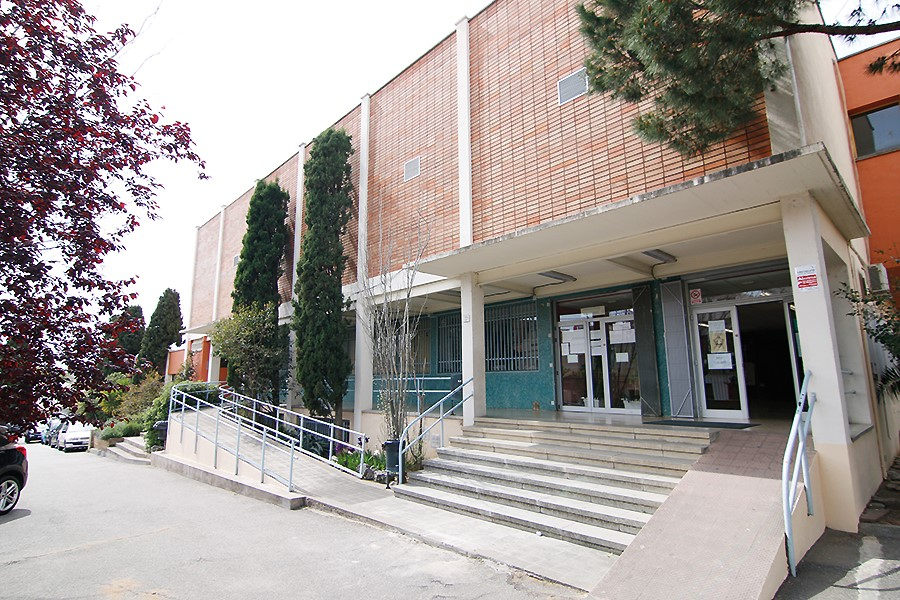

## 👋 Hi, I'm Gor Arakelyan Hovhannisyan
#### 🎓 Microcomputer Systems and Networks Student | 💻 Aspiring IT Professional

### 🧑‍💻 About Me

I'm currently a Microcomputer Systems and Networks (SMX) student with a strong interest in technology, computer systems, and especially video game development.

I'm passionate about learning how video games are created, from programming and game mechanics to design and the technologies behind them. I'm looking forward to expanding my knowledge and exploring new opportunities in the world of game development.

🎓 Currently studying Microcomputer Systems and Networks (SMX)
🎮 Passionate about video game development
🌱 Interested in learning about game engines, programming, and game design
💻 Exploring different technologies and tools
🚀 Looking forward to developing my own games and improving my skills
📚 Always learning something new

##
### 🛠️ Skills
#### 💻 Operating Systems

I have experience working with Windows and Linux (Ubuntu and Zorin),  
and I am developing my skills in operating system management and configuration.

#### 🔧 Hardware & Maintenance

I have intermediate-level experience with computer hardware,  
including disassembling PCs, identifying components, inspecting equipment,  
and performing basic hardware troubleshooting.

#### 🖥️ Software & User Management

I can install software, manage user accounts and permissions,  
and use productivity tools such as Microsoft Office and LibreOffice.

#### 🌐 Networking

I have a basic understanding of computer networking concepts and use  
Cisco Packet Tracer to explore network configurations and learn how networks work.

#### 👨‍💻 Programming & Web Development

I have basic knowledge of HTML and CSS for web development, as well as Python and Java programming.  
I have also used Scratch to learn programming fundamentals and logical thinking.

#### 🧰 Tools & Technologies

I use Git and GitHub for version control and project management. I also work with Visual Studio Code,  
VirtualBox, VMware, Cisco Packet Tracer, and command-line tools such as CMD, PowerShell, and the Linux Terminal.

#### 🌍 English

I have an intermediate level of English, which allows me to understand technical documentation,  
follow tutorials, and continue learning about new technologies.

##
### 💼 Internship Experience
#### 🏢 Develokat
  
IT Intern · march 2026 – may 2026

- Disassembled computer equipment and components.
- Sorted and classified different types of cables.
- Performed basic PC checks to verify hardware functionality.
- Assisted with computer hardware handling and inspection.
#### 🏢 Alexandre Satorras
  
IT Intern · september 2026 – Present

- Diagnosed laptop hardware and software issues.
- Installed and configured software applications.
- Assisted with laptop troubleshooting and maintenance.
- Helped ensure computers were properly configured and ready to use.

## 
### 🌍 Languages
Spanish: Native  
Catalan: Native  
Armenian: Native  
English: B2 not certificated  
French: A2  

##
### 📚 Education
#### 🎓 Microcomputer Systems and Networks (SMX) Escola Pia — 2025 -> Present

Throughout my studies, I have gained knowledge and worked on projects involving:  

- Computer Hardware and Maintenance  
- Operating Systems  
- Computer Networks  
- Network Configuration and Troubleshooting  
- Basic Programming  
- Database Fundamentals  
- Technical Support and IT Troubleshooting  
##
### 📫 Contact Me
#### Email: gorarakelyan152@gmail.com  
#### Phone number: +34 631 873 948
#### Linkedin: https://www.linkedin.com/in/gor-arakelyan-13916a3b6/
